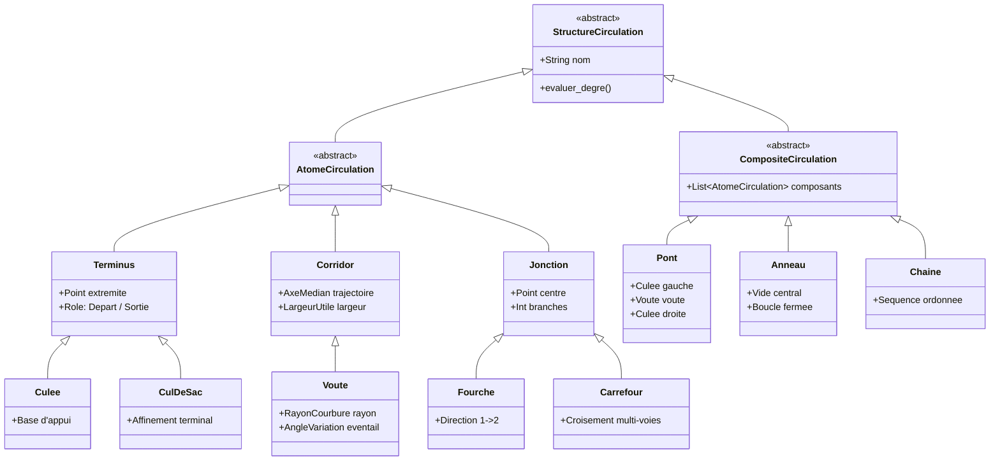

# G4_STRUCTURES_CIRCULATION — Structures de Circulation du Brodeur

Document d'analyse métier officielle — Étape G4.
Fait autorité sur l'interprétation des formes au-delà de la segmentation géométrique pure.

Références obligatoires :
- `docs/ARCHITECTURE_FONDATRICE.md`
- `docs/BRODEUR_VISION_MODEL.md`
- `docs/G2_CARTE_CONCEPTUELLE.md`
- `docs/G3_PROTO_VISION.md`

---

## 1. Structures observées

L'observation systématique des motifs de broderie et des cinq formes canoniques de référence révèle que le travail de l'aiguille est régi par un ensemble restreint de configurations de circulation :

| Forme canonique | Topologie perçue par le brodeur | Comportement cinématique du fil |
| :--- | :--- | :--- |
| **Rectangle (20 × 20 mm)** | **Chambre unitaire** (salle libre) | Balayage homogène à angle unique. L'aiguille y évolue sans contrainte d'étranglement ni risque de capture. |
| **Forme en U (20 × 20 mm)** | **Canal en U** (2 culées/jambes + 1 traverse) | Circulation bilatérale obligatoire : entrée par une extrémité, traversée du couloir bas, sortie par la seconde extrémité. |
| **Trou / Cadre (40 × 40 mm)** | **Anneau fermé** (circuit circulaire) | Boucle continue sans extrémité libre. Nécessite un tour complet et un raccordement sans surépaisseur au point de fermeture. |
| **Concave / Chevron (30 × 10 mm)** | **Bifurcation / Dièdre** (2 ailes divergentes) | Convergence vers un seuil central minimal. Deux orientations de remplissage divergentes de part et d'autre du col. |
| **Arche (429,5 × 141,1 mm)** | **Pont** (2 culées verticales + 1 voûte cintrée) | Parcours de transfert : prise d'appui sur une culée, traversée continue de la voûte en éventail, terminaison sur la culée opposée. |

Au-delà de ces 5 formes, l'analyse des motifs industriels et alphabétiques (logos, lettres, entrelacs) met en évidence trois autres structures fondamentales :
- **La Fourche (Bifurcation en Y)** : un corridor principal se séparant en deux branches divergentes (ex. lettres *Y*, branches végétales).
- **Le Carrefour (Jonction en T ou en X)** : croisement de corridors avec recouvrement central (ex. lettres *T*, *X*, croix).
- **Le Peigne / Râteau** : une dorsale de transit alimentant une série de culs-de-sac parallèles (forme critique pour l'ordre de visite).

---

## 2. Structures géométriques vs Fonctions de circulation

L'enseignement fondamental de l'étape G3.1 réside dans la séparation étanche entre **géométrie spatiale** et **fonction de circulation** :

```
┌─────────────────────────────────┐        ┌──────────────────────────────────┐
│      ZONE GÉOMÉTRIQUE           │        │     FONCTION DE CIRCULATION      │
│  (Ce que la matière EST)        │   ≠    │  (Ce que le fil y FAIT)          │
│  - Silhouette et vides          │        │  - Amorçage (départ)             │
│  - Distance au bord (chanfrein) │        │  - Transit (couloir / voûte)     │
│  - Cols minimaux locaux         │        │  - Terminaison (sortie)          │
│  - Région connexe fermée        │        │  - Réorientation d'angle         │
└─────────────────────────────────┘        └──────────────────────────────────┘
```

### Critères de distinction :

1. **La zone géométrique est statique et isotrope** :
   Elle découpe l'espace en composantes connexes d'après les rétrécissements de matière (cols physiques). Elle ignore d'où vient l'aiguille, où elle va, et comment le fil doit être orienté pour préserver la tenue textile.
2. **La fonction de circulation est cinématique et anisotrope** :
   Elle qualifie le rôle d'un espace dans le cheminement global du fil :
   - Un espace géométriquement continu peut cumuler **plusieurs fonctions de circulation distinctes** (ex. amorçage rectiligne puis transit tournant).
   - Une fonction de circulation impose des contraintes physiques textiles : **angle de trame adapté à la direction du couloir**, vitesse de balayage, et obligation de ne jamais traverser une zone déjà cousue sans couverture future.

---

## 3. Structures métier

Pour combler l'écart entre le découpage spatial brut et la réalité textile, les structures métier suivantes complètent le modèle de perception :

### A. Structures élémentaires (Fonctions locales)
- **Culée (ou Pôle terminal)** : Région d'extrémité ouverte, massive et stable, servant d'assise. C'est le lieu d'élection du départ ou de la sortie. On y entre ou on en sort, mais on n'y transite pas.
- **Voûte** : Zone de transition curviligne dont l'épaisseur est substantielle mais dont l'axe médian présente un rayon de courbure marqué. La voûte se caractérise par la nécessité d'un **angle de broderie adaptatif (en éventail)** pour épouser le cintre.
- **Corridor (ou Couloir)** : Tube de matière allongé (ratio longueur/largeur élevé) reliant deux nœuds. Règle absolue du brodeur : *un corridor se traverse d'un seul jet en continu et ne se coud jamais en deux passes*.
- **Épaule** : Zone de coude ou d'inflexion où la matière change brusquement d'axe directeur (jonction entre une culée verticale et une voûte cintrée, ou angle d'un cadre).

### B. Structures nodales (Topologie de décision)
- **Fourche** : Nœud de séparation $1 \rightarrow 2$. Exige de traiter la première branche en cul-de-sac (aller-retour sous couverture ou finition sur la pointe) avant d'engager la seconde.
- **Carrefour** : Nœud de croisement multiple ($3$ ou $4$ branches). Zone à forte densité de matière, idéale pour ancrer un point de reprise discret.
- **Chaîne** : Séquence linéaire de zones liées sans embranchement ($T_1 \leftrightarrow C_1 \leftrightarrow C_2 \dots \leftrightarrow T_2$).

---

## 4. Divergence de l'Arche : Analyse et Résolution

### Le constat expérimental G3.1 :
- **Perception géométrique par cols minimaux** : **1 zone unique** (bande continue de 429,5 mm).
- **Perception du brodeur** : **3 zones articulées** (Culée gauche $\leftrightarrow$ Voûte cintrée $\leftrightarrow$ Culée droite) formant un **Pont**.

### Pourquoi aucun col géométrique n'apparaît sur l'Arche ?
Une analyse métrique rigoureuse des épaisseurs de matière sur l'Arche explique mathématiquement ce phénomène :
- Épaisseur à la base des culées : $\approx 61\text{ mm}$ ;
- Épaisseur aux épaules (transition culée/voûte) : $\approx 49,6\text{ mm}$ ;
- Épaisseur au zénith de la voûte (sommet) : $\approx 46,0\text{ mm}$.

**Démonstration** :  
Le point le plus étroit de l'Arche est son sommet ($46\text{ mm}$), et non ses épaules ($49,6\text{ mm}$). Par conséquent, un détecteur d'étranglement basé sur un minimum local de largeur ne trouvera **jamais** de col aux épaules. Si l'on forçait un seuil artificiel pour découper l'épaule à 50 mm, l'algorithme découperait aussi la voûte en plusieurs tranches transversales indésirables.

### Pourquoi le brodeur voit-il indubitablement un Pont ?
Le brodeur ne cherche pas un rétrécissement de matière. Il détecte une **rupture cinématique d'orientation** :
1. **L'orientation des parois** : Les parois extérieures des culées sont verticales ($\theta \approx 90^\circ$). Les parois de la voûte sont courbées et tendent vers l'horizontale au zénith ($\theta \approx 0^\circ$).
2. **Le besoin textile d'angle** : Si l'on brode l'arche avec un angle unique (ex. horizontal), les culées seront brodées en travers (satin ou tatami parfait à $90^\circ$), mais le sommet de la voûte sera cousu parallèlement à ses bords, ce qui déchire le tissu et crée des fils flottants immenses.
3. **L'inflexion aux épaules** : Aux coordonnées $(89; 70)$ et $(340; 70)$, l'intrados commence son arc de cercle. C'est l'emplacement où la direction du flux de matière bascule de la verticale vers la courbe.

**Conclusion fondamentale** :  
L'Arche n'est pas segmentée par un col de largeur. Elle est segmentée par la **courbure de son squelette médian** et la **variation d'angle de son vecteur directeur**.

---

## 5. Taxonomie proposée des structures de circulation

La taxonomie suivante formalise les structures de circulation pour le cerveau du numériseur, de l'élémentaire au composite :



### Table de classification des structures :

| Type | Catégorie | Degré | Propriété géométrique discriminante | Règle de broderie associée |
| :--- | :--- | :--- | :--- | :--- |
| **Cul-de-sac** | Atome (Terminus) | 1 | Zone terminale dont la largeur décroît vers le fond | À broder en tout premier, ou en tout dernier (impasse fatale). |
| **Culée** | Atome (Terminus) | 1 | Zone terminale ouverte, massive, à bords stables | Pôle d'entrée ou de sortie privilégié du bloc. |
| **Corridor** | Atome (Transit) | 2 | Élongation marquée le long d'un axe rectiligne | Traversée en passe unique, angle aligné ou normalisé. |
| **Voûte** | Atome (Transit) | 2 | Élongation le long d'un arc de courbure continue | Balayage en éventail obligatoire (orientation adaptative). |
| **Épaule / Coude** | Atome (Nœud) | 2 | Déviation brutale ($\Delta\theta > 30^\circ$) de l'axe directeur | Zone de transition de trame et de décalage de repères. |
| **Fourche** | Atome (Jonction) | 3 | Séparation d'un axe médian en deux branches | Exige de boucler une branche avant de franchir la seconde. |
| **Carrefour** | Atome (Jonction) | $\ge 4$ | Intersection centrale de plusieurs corridors | Matière épaisse : lieu d'élection d'un point de reprise couvert. |
| **Pont** | Macro-structure | — | Assemblage : Culée $\leftrightarrow$ Voûte $\leftrightarrow$ Culée | Parcours de transfert intégral sans rebroussement. |
| **Anneau** | Macro-structure | — | Cycle fermé de corridors entourant un vide | Parcours en boucle fermée avec reprise de raccord soignée. |
| **Chaîne** | Macro-structure | — | Suite linéaire alternée de corridors et cols | Parcours séquentiel unidirectionnel. |

---

## 6. Recommandations pour l'architecture future

Afin de permettre au moteur de percevoir les formes comme un maître brodeur sans dégrader la robustesse géométrique acquise, les recommandations suivantes sont formulées :

1. **Étendre la perception par l'analyse du squelette médian (Axe directeur)** :
   - Conserver la détection des cols étroits de G3.1 (indispensable pour les formes en U, peignes, concavités franches).
   - Compléter la perception par l'extraction de l'**axe médian (squelette)** pour identifier les **ruptures de courbure** (épaules de l'arche) même en l'absence de pincement de matière.
2. **Définir la Voûte par sa cinématique angulaire** :
   - Reconnaitre une voûte dès que l'axe médian présente un changement d'angle continu supérieur à $60^\circ$ le long d'une bande de largeur régulière.
3. **Préserver l'étanchéité des couches (G2)** :
   - La perception continue de décrire la forme (salles, voûtes, culées, anneaux).
   - Elle ne décide jamais de l'ordre de broderie ni de l'espacement des points.
4. **Alimenter la couche Stratégie (G5)** :
   - Dès qu'un **Pont** est perçu, la stratégie sait immédiatement que l'ordre naturel est :  
     $$\text{Culée A} \longrightarrow \text{Voûte (balayage adaptatif)} \longrightarrow \text{Culée B}$$
     éliminant d'emblée toute hésitation d'ordre glouton ou arrêt prématuré.
